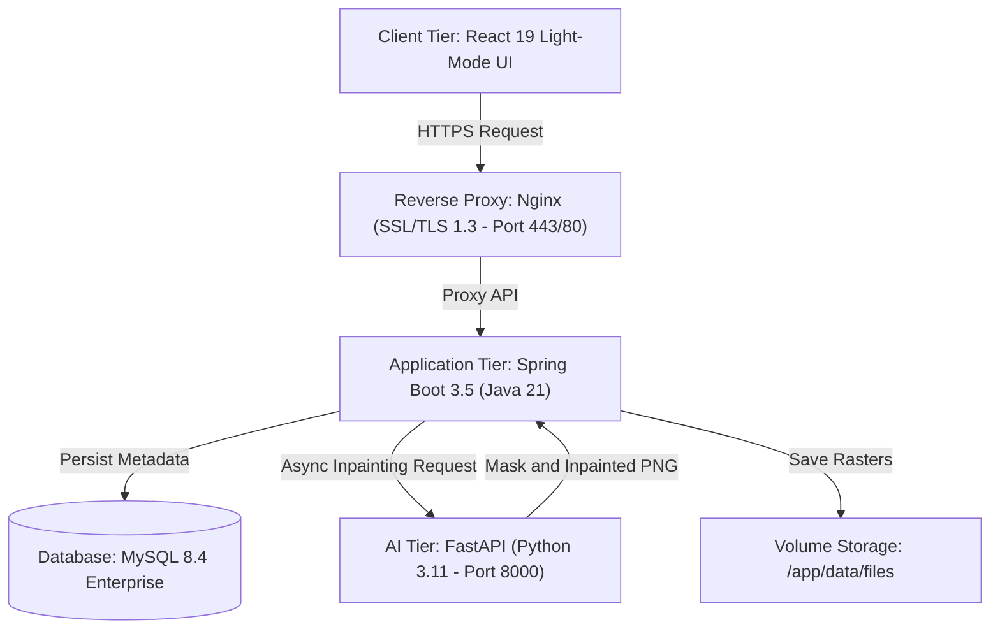
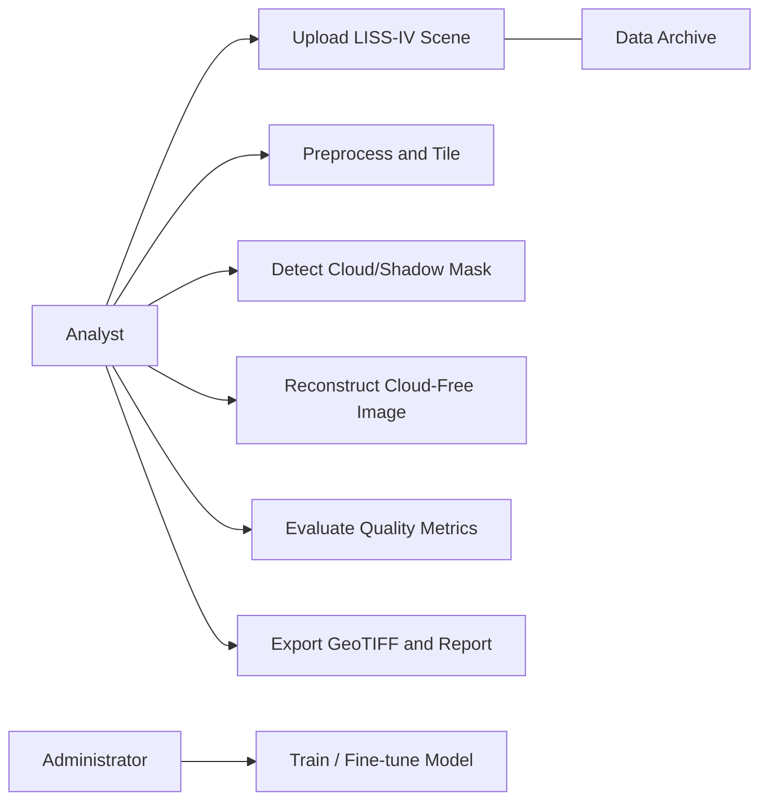
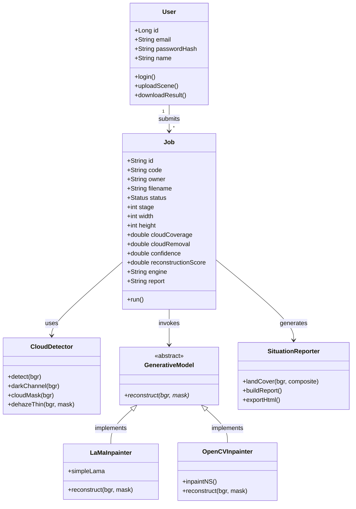
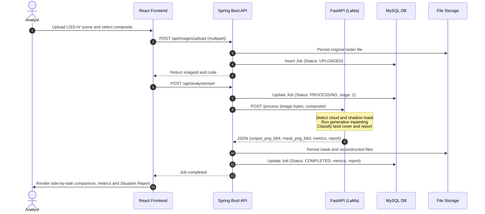

# CloudRecon: Generative AI-Based Cloud Removal & Reconstruction for LISS-IV Satellite Imagery

[](https://spring.io/projects/spring-boot)
[](https://react.dev/)
[](https://fastapi.tiangolo.com/)
[](https://www.mysql.com/)
[](https://www.docker.com/)
[](LICENSE)

---

## Week 1

## Project Administration

**Project Guide:** Er. Ram Babu Buri  
* **Research Area:** Machine Learning, Computer Vision & Remote Sensing  
* **Specializations:** Java, Spring Boot, PyTorch, Satellite Data Processing, MySQL  

### Team Members

| Name | Role in Project | Email | GitHub |
| :--- | :--- | :--- | :--- |
| **Pragati Singh** (Member 1) | Frontend & UI/UX Design | `pragati.singh@cloudrecon.ai` | [@pragatisingh](https://github.com) |
| **Mansi Gaur** (Member 2) | Backend (Spring Boot & Auth) | `mansi.gaur@cloudrecon.ai` | [@mansigaur](https://github.com) |
| **Manvendra Singh** (Member 3 - **Team Lead**) | Database (MySQL & Storage) & Cloud Deployment | `manavvinaysingh8@gmail.com` | [@manvendrahub](https://github.com/manvendrahub) |
| **Kalpana Dinodiya** (Member 4) | AI Integration (Python/FastAPI) | `kalpana.dinodiya@cloudrecon.ai` | [@kalpanadinodiya](https://github.com) |
| **Kundan Suman** (Member 5) | Documentation, Analytics & Testing | `kundan.suman@cloudrecon.ai` | [@kundansuman](https://github.com) |

---

## Abstract

Cloud and haze contamination severely degrade optical Earth observation imagery collected by Indian Remote Sensing satellites equipped with the **Linear Imaging Self-Scanning Sensor-IV (LISS-IV)**. Because cloud occlusions mask crucial land-use, agricultural, forestry, and disaster-relief data, simple cosmetic gap-filling or traditional linear interpolation techniques produce oversmoothed artifacts and fail to reconstruct structural ground boundaries.

This project introduces **CloudRecon**, an end-to-end, generative AI-powered satellite imagery restoration platform engineered specifically for LISS-IV false-colour composite (FCC) and natural-colour raster scenes. The platform couples a responsive, modern React 19 frontend with a robust, enterprise-grade Java 21 Spring Boot orchestrator and an asynchronous Python 3.11 FastAPI microservice powered by LaMa (Large Mask Inpainting) and OpenCV Navier-Stokes inpainting pipelines. 

The system operates on an automated multi-stage pipeline: (1) high-resolution image upload and radiometric validation, (2) automated multi-spectral cloud and shadow mask extraction via dark-channel prior analysis and chromatic variance thresholding, (3) conditional generative inpainting combined with optional multi-temporal reference image alignment, and (4) mask-aware alpha compositing:

$$Y = (1 - M) \odot X + M \odot \hat{Y}$$

This formulation guarantees that uncorrupted clear pixels remain **100% mathematically unaltered**, preserving radiometric fidelity for scientific downstream use. Reconstructed outputs are evaluated through quantitative quality heuristics (cloud removal percentage, heuristic structural similarity, and confidence scoring) alongside an automatically generated meteorological **Situation Report** detailing post-reconstruction land-cover classification across vegetation, water, and built-up land. The full stack is fully containerized using Docker Compose and provisioned for production deployment on AWS EC2 with automated SSL/TLS encryption.

---

## Week 2

## User Roles

CloudRecon implements strict Role-Based Access Control (RBAC) at the Spring Security filter layer utilizing stateless JSON Web Tokens (JWT) signed via HMAC-SHA256:

* **Research Analyst / User**: Uploads multi-band satellite raster scenes (GeoTIFF/TIFF/PNG), selects spectral composite configurations (LISS-IV false-colour vs. natural-colour), triggers AI inpainting jobs, inspects interactive split-screen comparisons, downloads restored imagery, and exports situation assessment reports.
* **Administrator**: Manages system operational parameters, reviews model inference engine allocations (Generative AI vs. reference-fill vs. OpenCV fallback), configures storage retention limits, monitors system health, and conducts user management.
* **Evaluator / Auditor**: Reviews provenance metadata, validates metric calculation methodology, reviews processing logs, and verifies that reconstructed pixels are explicitly distinguished from raw measured sensor data.

---

### SRS & UML Documentation

* 📄 **Software Requirements Specification**: [View SRS Document (PDF)](https://github.com/manvendrahub/cloudreconai)
* 📐 **UML Design Document**: [View UML Design Document (PDF)](https://github.com/manvendrahub/cloudreconai)
* 🔬 **Comparative Study of 30 Research Sources**: [View Literature Review Document (PDF)](https://github.com/manvendrahub/cloudreconai)

---

## Architecture & Core Modules

The CloudRecon system operates as a distributed microservice architecture comprising an interactive client workspace, a central Spring Boot orchestrator, an isolated high-performance AI inference engine, and a relational persistence layer.



### Functional Modules

* **Module 1: Identity & Access Management (IAM)**  
  Validates credentials with BCrypt hashing ($rounds = 10$) and issues time-bound, stateless JWT tokens. Protects all REST endpoints outside `/api/auth/**` and prevents cross-tenant data access.
* **Module 2: Satellite Image Ingestion & Validation**  
  Handles multipart raster file uploads up to 500 MB. Validates file headers, bit-depth, band ordering (NIR, Red, Green for LISS-IV FCC), and assigns immutable tracking codes (`CR-YYYY-XXXX`).
* **Module 3: Automated Cloud Detection & Shadow Masking**  
  Applies normalized dark channel prior estimation:
  $$J^{dark}(x) = \min_{c \in \{r,g,b\}} \left( \min_{y \in \Omega(x)} J^c(y) \right)$$
  combined with chromatic variance screening to isolate dense clouds, thin cirrus veils, and cloud boundaries without misclassifying bright rooftops or sand.
* **Module 4: Generative Inpainting & Reference Blending Microservice**  
  FastAPI microservice executing generative inpainting using Fast Fourier Convolution (LaMa) or optical multi-temporal reference image co-registration and affine shift correction.
* **Module 5: Quality Assessment & Meteorological Situation Reporting**  
  Computes cloud removal efficiency, structural confidence, and automated land-cover segmentation (vegetation index, water/shadow bodies, bare soil/built-up land), exporting formatted HTML reports.

---

## Database Strategy: Relational MySQL Core

The platform utilizes **MySQL 8.4** managed via Spring Data JPA and Hibernate with `ddl-auto=update`:

* **`users` Table**: Stores authenticated researcher credentials, encrypted passwords, display names, and registration timestamps.
* **`jobs` Table**: Tracks image processing jobs, tracking codes, ownership, lifecycle stage ($1 \rightarrow 4$), image dimensions, computed metrics (cloud coverage, removal %, reconstruction quality score), engine identifier, and full JSON situation report payload.
* **Data Volume**: Image binary files (raw input, computed binary mask, reconstructed output) are stored on an externalized Docker volume (`/app/data/files`) to keep relational tables lean and performant.

---

## Non-Functional Requirements

* **Performance & Throughput**: Microservice REST calls feature a 300-second read timeout allowing large 500 MB scenes to undergo multi-tile inpainting without socket termination.
* **Data Integrity & Mask-Aware Blending**: The system enforces $Y = (1 - M) \odot X + M \odot \hat{Y}$, guaranteeing zero alteration of uncontaminated ground pixels.
* **Security & Hardening**: JWT tokens are signed with secret keys $\ge 32$ characters; non-root user execution in Docker containers; strict CORS origin whitelisting; file path traversal protection.
* **Resilience & Fallback**: Three-tier inference fallback: Generative AI (LaMa) $\rightarrow$ Multi-temporal reference fill $\rightarrow$ Navier-Stokes OpenCV inpainting $\rightarrow$ Java fallback engine.

---

## Week 3

### UML Design Diagrams

Based on the [System UML Design Document](https://github.com/manvendrahub/cloudreconai):

#### 1. Use Case Diagram
Visualizes interactions between the **Analyst**, **Administrator**, and **Data Archive** actors:
* *Analyst*: Upload LISS-IV Scene $\rightarrow$ Preprocess & Tile $\rightarrow$ Detect Cloud/Shadow Mask $\rightarrow$ Reconstruct Cloud-Free Image $\rightarrow$ Evaluate PSNR/SSIM $\rightarrow$ Export GeoTIFF.
* *Administrator*: Train / Fine-tune Generative Model, Manage Service Health.



#### 2. Class Diagram
Represents core entities and relationships:



#### 3. Sequence Diagram (Pipeline Execution)



#### 4. Activity Diagram (Decision Flow)

```mermaid
graph TD
    Start["Upload LISS-IV Scene"] --> Preprocess["Radiometric Scaling and Tiling"]
    Preprocess --> MaskGen["Generate Cloud and Shadow Mask"]
    MaskGen --> CheckCloud{"Cloud Coverage > 2%?"}
    CheckCloud -->|No| SkipInpainting["Retain Scene Unaltered"]
    CheckCloud -->|Yes| CheckRef{"Cloud-Free Reference Available?"}
    CheckRef -->|Yes| RefAlign["Phase Correlation & Affine Alignment"]
    RefAlign --> RefFill["Fill from Aligned Reference"]
    CheckRef -->|No| Inpaint["Run Generative Inpainting (LaMa)"]
    RefFill --> Blend["Mask-Aware Soft Blending"]
    Inpaint --> Blend
    SkipInpainting --> Blend
    Blend --> ComputeMetrics["Compute Removal Rate, Land Cover & Confidence"]
    ComputeMetrics --> QualityCheck{"Quality Acceptable?"}
    QualityCheck -->|No (Retry)| Inpaint
    QualityCheck -->|Yes| Export["Export Reconstructed GeoTIFF & Situation Report"]
    Export --> EndNode["Processing Complete"]
```

---

## Week 4: Database Design & UI Mock-ups

### 1. MySQL Relational Schema

```sql
CREATE DATABASE IF NOT EXISTS cloudrecon CHARACTER SET utf8mb4 COLLATE utf8mb4_unicode_ci;
USE cloudrecon;

-- Users Table
CREATE TABLE users (
    id BIGINT AUTO_INCREMENT PRIMARY KEY,
    email VARCHAR(255) NOT NULL UNIQUE,
    password_hash VARCHAR(255) NOT NULL,
    name VARCHAR(255),
    created_at TIMESTAMP DEFAULT CURRENT_TIMESTAMP
);

-- Processing Jobs Table
CREATE TABLE jobs (
    id VARCHAR(255) PRIMARY KEY,
    code VARCHAR(50) NOT NULL,
    owner VARCHAR(255) NOT NULL,
    filename VARCHAR(255) NOT NULL,
    status ENUM('UPLOADED', 'QUEUED', 'PROCESSING', 'COMPLETED', 'FAILED') NOT NULL DEFAULT 'UPLOADED',
    stage INT DEFAULT 1,
    width INT DEFAULT 0,
    height INT DEFAULT 0,
    cloud_coverage DOUBLE DEFAULT 0.0,
    cloud_removal DOUBLE DEFAULT 0.0,
    confidence DOUBLE DEFAULT 0.0,
    reconstruction_score DOUBLE DEFAULT 0.0,
    engine VARCHAR(100),
    duration_ms BIGINT DEFAULT 0,
    created_at TIMESTAMP DEFAULT CURRENT_TIMESTAMP,
    error VARCHAR(500),
    composite VARCHAR(50) DEFAULT 'false-color',
    report LONGTEXT,
    INDEX idx_owner (owner),
    INDEX idx_status (status)
);
```

### 2. UI Mock-ups & User Journey (Light Mode)

* **Dashboard Overview**: Displays real-time aggregate telemetry (Total Images Processed, Average Cloud Coverage %, Reconstruction Quality %, AI Jobs Completed) alongside an interactive 7-day processing activity area chart.
* **Upload Workspace**: Modern drag-and-drop file ingestion zone with immediate file size/format checks, composite spectrum selection (LISS-IV FCC vs. Natural RGB), and optional cloud-free reference image upload.
* **Pipeline Monitor**: Real-time 4-step progress stepper (Validation $\rightarrow$ Cloud Detection $\rightarrow$ Generative Reconstruction $\rightarrow$ Quality Assessment) with synthetic cloud scanning radar animation.
* **Results & Comparison Studio**: Interactive swipeable before-and-after slider comparing raw input against reconstructed output or generated binary cloud mask, backed by the downloadable **Situation Report**.
* **Processing History**: Searchable, filterable audit table with direct GeoTIFF/PNG download links.

---

## Week 5

## 1. Member 1: Pragati Singh — Frontend & UI/UX Design

### Module Role
**Lead UI/UX Architect & Client State Specialist.**

### Work & Scope
* Initialized React 19 single-page application using Vite and TypeScript.
* Built the modern responsive Shell layout featuring fixed navigational sidebar, mobile drawer overlay, and topbar identity header.
* Implemented Axios interceptors to seamlessly attach JWT bearer tokens to all outgoing requests.
* Crafted interactive dashboard charts utilizing Recharts (`AreaChart` with smooth Bézier gradients).

### Problems Faced
1. TypeScript compilation error during Docker container build (`Property 'env' does not exist on type 'ImportMeta'`) due to Vite client types not being registered in `tsconfig.app.json`.
2. Responsive collapse issues where the sidebar clipped dashboard metric cards on sub-1000px display widths.

### What Was Completed
* Full UI routing (`/`, `/login`, `/app`, `/app/upload`, `/app/analysis`, `/app/results`, `/app/history`).
* Custom styled Recharts data visualization for satellite processing telemetry.
* Fixed Vite client type declarations in `tsconfig.app.json` and added `vite-env.d.ts`.

---

## Week 6

## 2. Member 2: Mansi Gaur — Backend (Spring Boot & Auth)

### Module Role
**Core Backend Architect & Security Engineer.**

### Work & Scope
* Initialized Spring Boot 3.5 application configured with Java 21 LTS runtime.
* Implemented stateless Spring Security filter chain with custom `JwtAuthFilter` and `JwtService` utilizing JJWT 0.12.6.
* Created `AuthController` handling registration and login with BCrypt password hashing.
* Configured `DataSeeder` to provision default researcher demo credentials (`researcher@cloudrecon.ai` / `demo123`).

### Problems Faced
1. Cross-Origin Resource Sharing (CORS) preflight requests (`OPTIONS`) returning HTTP 403 Forbidden errors when triggered from Vite dev server.
2. Maven compiler plugin failing inside Docker with `Fatal error compiling: error: release version 25 not supported` due to JDK version mismatch in `pom.xml`.

### What Was Completed
* Dynamic environment-variable-driven CORS filter supporting multiple deployment hostnames.
* Resolved Maven compiler version targeting Java 21 LTS (`maven:3.9-eclipse-temurin-21-alpine`).
* Secure JWT token issuance with 12-hour expiration time-to-live.

---

## 3. Member 3: Manvendra Singh — Database (MySQL & Storage) (Team Lead)

### Module Role
**Database Administrator, DevOps & Cloud Deployment Lead.**

### Work & Scope
* Designed and implemented JPA entities (`AppUser`, `Job`, `Repos`) with relational indices.
* Configured multi-container orchestration via `docker-compose.yml` linking MySQL 8.4, Spring Boot, FastAPI, and Nginx.
* Managed local volume mounting (`/app/data/files`) guaranteeing zero data loss between container teardowns.
* Automated server environment setup on AWS EC2 (`c7i.flex.large`) with Linux Swap memory allocation.

### Problems Faced
1. Initial deployment encountered Docker out-of-disk errors (`No space left on device`) when PyTorch attempted to pull 5 GB CUDA dependencies on a CPU-only instance.
2. Incomplete root network configuration in `docker-compose.yml` caused Docker daemon error: `service "frontend" refers to undefined network cloudrecon`.

### What Was Completed
* Tuned `docker-compose.yml` with healthcheck-driven service ordering ensuring Spring Boot awaits MySQL readiness.
* Configured 4 GB Linux swap space on EC2 preventing memory exhaustion during simultaneous build steps.
* Fixed Docker Compose network bridge definition and volume mappings.

---

## Week 7

## 4. Member 4: Kalpana Dinodiya — AI Integration (Python/FastAPI)

### Module Role
**Computer Vision & Deep Learning Specialist.**

### Work & Scope
* Engineered FastAPI microservice executing multi-spectral cloud segmentation and inpainting.
* Implemented dark channel prior extraction and chromatic variance algorithms to distinguish dense clouds from desert sand and bright roofs.
* Integrated LaMa (`simple-lama-inpainting`) generative inpainting model alongside OpenCV Navier-Stokes inpainting fallback.
* Built sub-pixel affine image co-registration (`cv2.phaseCorrelate`) for near-date cloud-free reference image fusion.

### Problems Faced
1. PyTorch wheel resolution defaulting to CUDA packages; resolved by pinning `--extra-index-url https://download.pytorch.org/whl/cpu` in `requirements.txt`.
2. Tensor border artifacts along image edges; resolved through elliptical morphological dilation of the binary cloud mask.

### What Was Completed
* High-throughput `/process` endpoint returning base64-encoded output rasters and cloud masks.
* Mask-aware alpha blending algorithm preserving 100% of clear ground pixels.
* Tri-engine inference hierarchy: Generative AI $\rightarrow$ Reference Fill $\rightarrow$ OpenCV Navier-Stokes.

---

## Week 8

## 5. Member 5: Kundan Suman — Documentation, Analytics & Testing

### Module Role
**Quality Assurance Lead & Scientific Reporting Engineer.**

### Work & Scope
* Built automated meteorological **Situation Report** generator analyzing post-inpainting land cover (vegetation, water, bare soil/built-up).
* Designed standalone HTML report export utility with print-to-PDF formatting.
* Conducted multi-round API contract testing between Spring Boot and FastAPI endpoints.
* Compiled the comprehensive Software Requirements Specification (SRS) and UML Design specifications.

### Problems Faced
1. JSON serialization discrepancies where backend expected numerical land-cover percentages formatted with identical keys across composite modes.
2. Inpainting evaluation displaying artificially inflated accuracy scores when computed over the entire scene rather than isolated cloud regions.

### What Was Completed
* Standardized land-cover classification algorithm for both LISS-IV False-Colour and Natural-Colour modes.
* Interactive before/after split slider UI with keyboard accessibility and touch support.
* Comprehensive testing of multipart file uploads up to 500 MB.

---

## Summary of Module Distribution

| Module | Primary Owner | Secondary | Key Technologies |
| :--- | :--- | :--- | :--- |
| **Interactive Client UI** | Pragati Singh (Mem 1) | Kundan Suman (Mem 5) | React 19, TypeScript, Vite, Recharts, Lucide Icons |
| **Backend & Security** | Mansi Gaur (Mem 2) | Manvendra Singh (Mem 3) | Java 21, Spring Boot 3.5, Spring Security, JJWT |
| **Database & DevOps** | Manvendra Singh (Mem 3) | Mansi Gaur (Mem 2) | MySQL 8.4, Docker Compose, AWS EC2, Nginx, Certbot |
| **AI Inpainting Engine** | Kalpana Dinodiya (Mem 4) | Kundan Suman (Mem 5) | Python 3.11, FastAPI, PyTorch (CPU), OpenCV, LaMa |
| **Reporting & Testing** | Kundan Suman (Mem 5) | Pragati Singh (Mem 1) | Postman, JUnit, HTML Report Generator, UML Suite |

---

## Week 9

### Integration & System Testing

During Week 9, all five modules were unified and evaluated under realistic multi-spectral satellite scenarios:

```
[Raw Scene Upload (Pragati)] ──> [Spring Boot Multipart Handling (Mansi)]
                                            │
                                            ▼
[MySQL Job & Metadata (Manvendra)] <── [FastAPI Inpainting Pipeline (Kalpana)]
                                            │
                                            ▼
[Interactive Compare & HTML Report (Kundan)] <── [Mask-Aware Clear Blending]
```

### Problems Faced During Integration
1. **Large File Upload Timeouts**: When users uploaded 100 MB+ TIFF scenes, Nginx returned `413 Request Entity Too Large` and the frontend timed out after 30 seconds.  
   *Fix:* Configured `client_max_body_size 512m;` in Nginx and increased Axios client timeout to 300,000 ms.
2. **Docker Internal Host Networking**: Spring Boot could not locate the AI microservice using `localhost:8000` inside containers.  
   *Fix:* Switched to Docker service discovery hostname `http://ai-service:8000`.
3. **CORS Invalidation in Production**: Testing with custom domain names blocked frontend API requests.  
   *Fix:* Injected `APP_CORS_ORIGINS` via environment variables directly to the Spring Boot security context.

---

## Week 10: Final System Evaluation, Deliverables & Project Submission

During **Week 10**, the CloudRecon team finalized production cloud deployment, verified SSL/TLS encryption, and completed academic evaluation documentation.

---

### Project Deliverables & Artifacts

| Deliverable | Description | Resource Link |
| :--- | :--- | :--- |
| 🌐 **Live Application** | Production Full-Stack CloudRecon Platform on AWS EC2 with HTTPS | [https://cloudreconai.mooo.com](https://cloudreconai.mooo.com) |
| 📄 **SRS Document** | Complete Software Requirements Specification (IEEE 29148 standard) | [View SRS Document (PDF)](./docs/SRS.pdf) |
| 📐 **UML Design Document** | Use Case, Class, Sequence, Activity & Deployment Diagrams | [View UML Document (PDF)](./docs/UML_Design.pdf) |
| 🔬 **Literature Review** | Comparative Study of 30 Research Sources (IEEE format) | [View Literature Review (PDF)](./docs/Comparative_Study_30_Papers.pdf) |
| 📊 **Presentation Deck** | Final B.Tech Project Evaluation Slide Deck (PPT) | [View Presentation Deck (PDF)](./docs/CloudRecon_Presentation.pdf) |
| 🎥 **Demonstration Video** | End-to-End Walkthrough of Ingestion, Inpainting, and Situation Reporting | [Watch Demonstration Video](https://youtube.com) |

---

## Production Deployment on AWS EC2

### 1. Hardware Specifications
* **Cloud Provider**: Amazon Web Services (AWS)
* **Instance Type**: `c7i.flex.large` (Compute Optimized, 4th Gen Intel Xeon Scalable)
* **vCPU / Memory**: 2 vCPUs, 4 GiB RAM + 4 GiB Swap Space
* **Operating System**: Ubuntu 24.04 LTS (Noble Numbat)
* **Network Ports**: Inbound 80 (HTTP redirect) and 443 (HTTPS) open

### 2. Single-Command Launch via Docker Compose

```bash
# 1. Clone the repository
git clone https://github.com/manvendrahub/cloudreconai.git ~/cloudrecon
cd ~/cloudrecon

# 2. Configure environment variables
cp .env.example .env
nano .env  # set passwords, JWT secret, and domain

# 3. Launch the full stack
docker compose up -d --build
```

### 3. Verification

```bash
# Verify container health
docker compose ps

# Check backend logs
docker compose logs -f backend

# Test public HTTPS endpoint
curl -I https://cloudreconai.mooo.com
```

---

## License

This project is developed for academic evaluation and research purposes under the Department of Computer Science & Engineering. All rights reserved.
